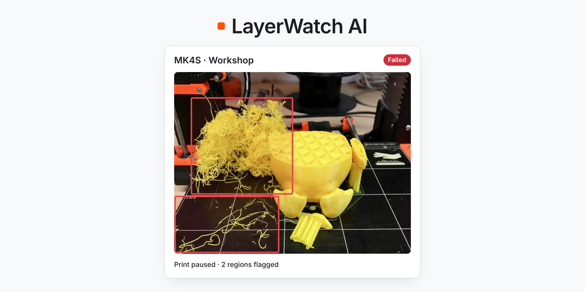

# LayerWatch AI: Prusa Connect extension



> Formerly called Print Guard. It is not related to the independent
> [PrintGuard](https://oliverbravery.github.io/PrintGuard/) project.

LayerWatch AI watches your printer cameras in Prusa Connect and **pauses a print that has
visibly failed** (spaghetti, a part knocked loose, a blob). It runs inside the Connect
server's own extension process, so **no browser tab has to stay open**.

## How it works

1. You switch on **periodic capture** for a printer's camera in Prusa Connect. The server
   then stores a snapshot on that cadence and publishes the event
   `com.prusa.connect.camera.snapshot.captured`.
2. LayerWatch AI subscribes to that event, reads the JPEG from the storage, and asks the
   printer whether it is `PRINTING`. It judges nothing between prints or while paused.
3. A **detector** scores the frame:
   - `obico`: your self-hosted [Obico ML API](https://github.com/TheSpaghettiDetective/obico-server/tree/release/ml_api)
     with Obico's trained failure-detection model. This is the AI option and the more accurate one.
   - `heuristic` (built in, no setup): compares each frame with a slowly adapting
     background and counts cells that changed *and* turned into dense, tangled edges.
     A global light change is taken out, and steady layer growth is absorbed.
4. A tracker follows the score over the print. It compares an EWMA of recent frames
   with a baseline built from the unsuspicious frames. It skips the first frames of a
   print (warm-up), so one bad frame never fails a print.
5. Once the excess passes the threshold, LayerWatch AI sends `core.command.pause_print`
   (or only reports, with `action: notify`). It stores an incident and publishes
   `failure.detected`. It acts **once per print**: if you resume, the picture becomes
   the new normal.

## Before the first start

- **Record store.** LayerWatch AI keeps its incidents in the module record
  store. Until the operator declares a record backend under `resources.db`
  (for example `type: core/sqlite`), the module reports
  `RESOURCE_RECORDS_UNSERVED` and does not start.
- **Pausing needs the operator role.** Approving the install grants
  `observe` and `read_storage`. `operate`, which pausing needs, also needs
  the operator role on each printer. Without that grant LayerWatch AI can only
  notify, so grant it before you set `action` to `pause`.

## The page

**LayerWatch AI** in the Connect sidebar shows every camera with its live picture,
its verdict (warming up, OK, suspicious, failed) and the trend above normal.
**False alarm** makes the current picture the new normal. Below are the incidents,
each with the frame it was judged on. The page refreshes every 10 seconds.

## Settings

| key | default | meaning |
| --- | --- | --- |
| `detector` | `auto` | `heuristic`, `obico`, or `auto` (obico when `obico_url` is set) |
| `action` | `pause` | `pause` or `notify` |
| `sensitivity` | `1` | 2 reacts to half the evidence, 0.5 needs twice as much |
| `warmup_frames` | `5` | snapshots never judged at the start of a print and after a resume |
| `obico_url` | | e.g. `http://192.168.1.20:3333` |
| `obico_token` | | the `ML_API_TOKEN` of your ML API, if set |
| `frame_base_url` | | how the ML API reaches this server's frames port, e.g. `http://192.168.1.10:18491` |

```yaml
resources:
  sink:
    layerwatch-ai:
      config:
        detector: obico
        obico_url: http://192.168.1.20:3333
        frame_base_url: http://192.168.1.10:18491
```

### Obico ML API

The Obico ML API fetches the picture from a URL itself. LayerWatch AI therefore serves each
frame once, under a random path, for at most a minute, on the `frames` port (TCP 18491).
The operator approves that port at install. Start the ML API, for example from the
obico-server repository:

```bash
docker compose up -d ml_api
```

## Routes

| route | answer |
| --- | --- |
| `GET /status` | detector, action, and for each camera: printer, verdict, score, frames |
| `GET /incidents?printer=<id>` | stored incidents, newest first (50 per printer) |
| `POST /printers/{printer}/reset` | false alarm: the baseline starts over |

## Build

```bash
make check
```

```bash
make release
```

`make core` clones Prusa Connect `v0.1.0-beta.1` into `.core/` (the SDK is not yet
published as a Go module). Publishing follows the
[marketplace docs](https://plugin-marketplace.prusa3d.com/docs/connect/github-actions).

## Limits

- The heuristic is not a trained model. A person in the frame or a moving camera can
  raise its score. Use Obico for reliable detection.

## Installing Obico

An extension cannot start containers, so Obico is set up with one command on
the machine that should run it (Linux, macOS with Docker Desktop, x86-64 or
ARM64, about 2 GiB RAM and 6 GiB disk):

```sh
curl -fsSLo install-obico.sh https://raw.githubusercontent.com/leotrax3d/layerwatch-ai/main/scripts/install-obico.sh && sh install-obico.sh
```

If Prusa Connect runs on another machine, add its address:
`sh install-obico.sh 192.168.1.20`. The script checks the hardware and Docker, builds and starts Obico's ML API on port 3333 and
prints a setup code. Paste it into LayerWatch AI's Setup card and press "Save
and test". Obico's ML API has no password: keep port 3333 inside your network.

## Licenses and Obico

LayerWatch AI is licensed as stated in LICENSE. It ships no AI model and no
Obico code: the `obico` detector only calls an Obico ML API server you run
yourself.

- Obico server: https://github.com/TheSpaghettiDetective/obico-server,
  licensed under the GNU AGPL v3. The ML API lives in its `ml_api` directory.
- The failure-detection model and its weights come from the Obico project and
  are downloaded by that server, under Obico's terms. LayerWatch AI does not
  redistribute them.
- The obico_token option is only for an ML API behind a proxy that checks a
  bearer token; Obico's own ML API checks none.
- If you modify and offer the Obico server to others over a network, the
  AGPL requires you to offer them its source.

## Publishing

`.github/workflows/release.yml` follows the
[GitHub Actions guide](https://plugin-marketplace.prusa3d.com/docs/connect/github-actions).
Raise `version` in `module.yaml`, add it to `CHANGELOG.md`, then:

```bash
gh release create v0.1.0 --title "LayerWatch AI 0.1.0" --notes-file CHANGELOG.md
```
